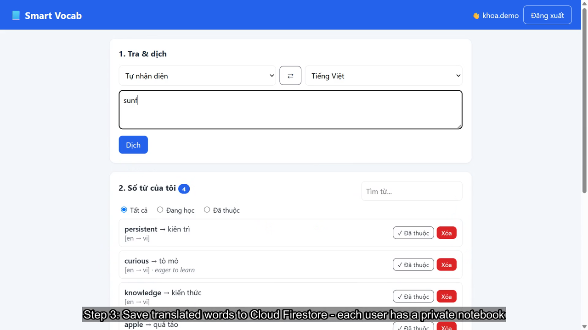
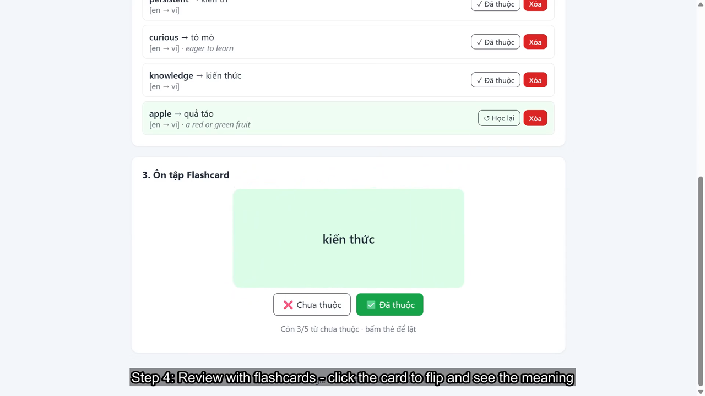

# Lab07 – Google Translate API & Firebase API

**Họ tên:** Nguyễn Đăng Khoa · **MSSV:** 23125084

**Sản phẩm:** Smart Vocab – Sổ từ vựng thông minh

| Mục | Link |
|---|---|
| 🌐 Website (live) | https://smart-vocab-d4665.web.app |
| 💻 Source code | https://github.com/KBFrom0/Private_ComputationalThinking |
| 🎬 Video demo | https://github.com/KBFrom0/Private_ComputationalThinking/blob/main/docs/demo.mp4 |

---

## 1. Explanation – Giới thiệu website

### 1.1 Ý tưởng
Khi học ngoại ngữ, người học thường tra từ bằng Google Translate rồi quên ngay vì không có chỗ lưu lại để ôn. **Smart Vocab** gộp ba bước *tra từ → lưu từ → ôn tập* vào một website duy nhất:

- Tra nghĩa bằng **Google Translate API**.
- Lưu vào sổ từ cá nhân trên đám mây bằng **Firebase (Authentication + Cloud Firestore)**, dùng được trên mọi thiết bị.
- Ôn tập bằng **Flashcard** cho đến khi thuộc.

Website được triển khai trên **Firebase Hosting** tại https://smart-vocab-d4665.web.app.

### 1.2 Chức năng

| # | Chức năng | Mô tả | API sử dụng |
|---|-----------|-------|-------------|
| 1 | Tra & dịch | Dịch từ/câu giữa 8 ngôn ngữ, tự nhận diện ngôn ngữ nguồn, đổi chiều dịch | Google Translate |
| 2 | Đăng nhập | Đăng nhập bằng tài khoản Google hoặc Email/Mật khẩu (có đăng ký) | Firebase Authentication |
| 3 | Lưu từ | Lưu từ kèm nghĩa và ghi chú, chặn lưu trùng | Cloud Firestore |
| 4 | Quản lý sổ từ | Xem, tìm kiếm, lọc (đang học / đã thuộc), đánh dấu, xóa. Đồng bộ realtime | Cloud Firestore |
| 5 | Flashcard | Lật thẻ xem nghĩa, đánh dấu "đã thuộc" / "chưa thuộc", đếm số lần ôn | Cloud Firestore |
| 6 | Bảo mật dữ liệu | Mỗi người dùng chỉ đọc/ghi được sổ từ của mình | Firestore Security Rules |

### 1.3 Ảnh chụp màn hình

**Dịch từ bằng Google Translate API (tự nhận diện tiếng Anh → tiếng Việt):**


**Lưu từ vào sổ trên Cloud Firestore:**



**Tìm kiếm, lọc và đánh dấu "đã thuộc":**


**Ôn tập bằng Flashcard:**



### 1.4 Kiến trúc

```
Trình duyệt (HTML/CSS/JavaScript thuần, ES Modules)
 ├── js/translate.js ──HTTP──► Google Translate API
 └── js/firebase.js  ──SDK───► Firebase Authentication (Google, Email/Password)
                              └► Cloud Firestore: users/{uid}/words/{wordId}
Triển khai: Firebase Hosting
```

| File | Vai trò |
|------|---------|
| `index.html`, `css/style.css` | Giao diện |
| `js/app.js` | Xử lý sự kiện, hiển thị sổ từ, flashcard |
| `js/translate.js` | Gọi Google Translate API |
| `js/firebase.js` | Khởi tạo Firebase, Auth và các thao tác Firestore |
| `js/config.js` | Cấu hình Firebase và API key (không commit, đã `.gitignore`) |
| `firestore.rules` | Luật bảo mật Firestore |
| `firebase.json`, `.firebaserc` | Cấu hình triển khai Firebase |

Website là **ứng dụng tĩnh, không cần backend riêng**: mọi logic chạy ở trình duyệt, dữ liệu lưu trên Firestore và được bảo vệ bằng Security Rules.

### 1.5 Tích hợp Google Translate API (`js/translate.js`)

Hàm `translate(text, target, source)` hỗ trợ hai cách gọi:

**a) Google Cloud Translation API v2 (chính thức, dùng API key):**
```js
const res = await fetch(
  `https://translation.googleapis.com/language/translate/v2?key=${TRANSLATE_API_KEY}`,
  {
    method: "POST",
    headers: { "Content-Type": "application/json" },
    body: JSON.stringify({ q: text, target, source, format: "text" }),
  }
);
const t = (await res.json()).data.translations[0];
// t.translatedText, t.detectedSourceLanguage
```

**b) Endpoint công khai của Google Translate (khi chưa có API key):**
```js
const params = new URLSearchParams({ client: "gtx", sl: source, tl: target, dt: "t", q: text });
const data = await (await fetch(`https://translate.googleapis.com/translate_a/single?${params}`)).json();
// data[0] = các đoạn đã dịch, data[2] = ngôn ngữ nguồn nhận diện được
```

- Khi chọn "Tự nhận diện", API trả về ngôn ngữ nguồn. Giá trị này được hiển thị (ví dụ *Tiếng Anh → Tiếng Việt*) và lưu kèm từ.
- Bản demo dùng cách (b). Để chuyển sang Cloud Translation API chỉ cần điền `TRANSLATE_API_KEY` trong `js/config.js`, không phải sửa code.

### 1.6 Tích hợp Firebase (`js/firebase.js`)

**Authentication:** hỗ trợ 2 phương thức, theo dõi trạng thái đăng nhập bằng `onAuthStateChanged`.
```js
export const login = () => signInWithPopup(auth, new GoogleAuthProvider());
export const loginWithEmail = (email, password) =>
  signInWithEmailAndPassword(auth, email, password);
export const onUserChanged = (cb) => onAuthStateChanged(auth, cb);
```

**Cloud Firestore:** mỗi người dùng có một sub-collection riêng `users/{uid}/words`.
```js
addDoc(collection(db, "users", uid, "words"), {
  text, translated, source, target, note,
  learned: false, reviewCount: 0, createdAt: serverTimestamp(),
});
```
- **Đọc realtime** bằng `onSnapshot` (sắp xếp theo `createdAt`). Khi thêm, xóa hoặc đánh dấu, giao diện tự cập nhật trên mọi tab và thiết bị.
- **Cập nhật** bằng `updateDoc` (trạng thái `learned`, `reviewCount` khi ôn flashcard), **xóa** bằng `deleteDoc`.

**Security Rules** (`firestore.rules`): người dùng phải đăng nhập và chỉ truy cập được dữ liệu có `userId` trùng với `uid` của mình.
```
match /users/{userId}/words/{wordId} {
  allow read, write: if request.auth != null && request.auth.uid == userId;
}
```

**Firebase Hosting:** triển khai bằng `firebase deploy --only hosting`.

### 1.7 Hướng dẫn chạy
Xem chi tiết trong `README.md`. Tóm tắt:
1. `cp js/config.example.js js/config.js`, rồi điền `firebaseConfig` (và `TRANSLATE_API_KEY` nếu có).
2. Trong Firebase Console: bật Authentication (Google, Email/Password), tạo Firestore và áp dụng `firestore.rules`.
3. Chạy local bằng `npx serve .`, hoặc triển khai bằng `firebase deploy`.

---

## 2. Source Code
- Repository: https://github.com/KBFrom0/Private_ComputationalThinking
- Các file chính: `index.html`, `css/style.css`, `js/app.js`, `js/translate.js`, `js/firebase.js`, `firestore.rules`, `firebase.json`.

## 3. Video Demonstration
- Video (khoảng 2 phút, phụ đề tiếng Anh): https://github.com/KBFrom0/Private_ComputationalThinking/blob/main/docs/demo.mp4
- File phụ đề riêng: `docs/demo-subtitles-en.srt`
- Nội dung video:
  1. Dịch từ *serendipity* (tự nhận diện tiếng Anh → tiếng Việt), dịch câu tiếng Việt → tiếng Nhật.
  2. Đăng nhập bằng Firebase Authentication (Email/Password).
  3. Dịch và lưu 5 từ vào Cloud Firestore, có ghi chú.
  4. Tìm kiếm, đánh dấu đã thuộc, lọc theo trạng thái.
  5. Ôn tập bằng Flashcard.
  6. Tải lại trang để thấy dữ liệu vẫn còn trên cloud, sau đó đăng xuất.

## 4. AI Usage Declaration
Trong quá trình làm bài, em sử dụng công cụ AI **Claude Code (mô hình Claude Opus 5.5 của Anthropic)** với vai trò trợ lý lập trình:

| Hạng mục | AI hỗ trợ | Em thực hiện |
|----------|-----------|--------------|
| Ý tưởng | Gợi ý 5 ý tưởng đề tài | Chọn đề tài *Sổ từ vựng thông minh* |
| Mã nguồn | Sinh mã HTML/CSS/JS, module Translate, Firebase Auth/Firestore, Flashcard, đăng nhập Email | Đọc hiểu, chạy thử và kiểm tra chức năng |
| Cấu hình Firebase | Tạo web app, Firestore, deploy rules và hosting qua Firebase CLI | Tạo project Firebase, đăng nhập CLI, bật Google và Email/Password trong Console |
| Kiểm thử | Chạy thử trên trình duyệt, phát hiện và sửa lỗi giao diện | Kiểm tra lại trên trình duyệt của mình |
| Video demo | Điều khiển trình duyệt tự động để quay video, tạo phụ đề tiếng Anh | Xem lại video |
| Tài liệu | Soạn README, báo cáo này, xuất PDF | Cung cấp thông tin cá nhân, xem lại nội dung |

Các commit có sự hỗ trợ của AI đều ghi dòng `Co-Authored-By: Claude` trong lịch sử Git. Em hiểu toàn bộ mã nguồn và chịu trách nhiệm về nội dung nộp.

## 5. Git Commit History
Lệnh: `git log --pretty=format:"%h | %ad | %s" --date=format:"%Y-%m-%d %H:%M"`

```
68c54cb | 2026-11-25 01:57 | Thêm video demo (phụ đề tiếng Anh) và cập nhật README
47f79eb | 2026-11-25 01:44 | Thêm đăng nhập/đăng ký bằng Email & mật khẩu (Firebase Auth)
5fd9c93 | 2026-11-25 01:36 | Liên kết project Firebase smart-vocab-d4665
8f9fd84 | 2026-11-25 01:06 | Thêm báo cáo nộp bài docs/REPORT.md
6d9b23a | 2026-11-25 01:06 | Sửa lỗi khung kết quả không ẩn, thêm favicon và chỉnh màu nút đăng nhập
3e04ad9 | 2026-11-25 01:05 | Thêm Firestore security rules, cấu hình Hosting và README hướng dẫn
7bc04b6 | 2026-11-25 01:05 | Thêm chế độ ôn tập Flashcard: lật thẻ, đánh dấu đã thuộc/chưa thuộc
ca1da3e | 2026-11-25 01:04 | Tích hợp Firebase: đăng nhập Google, lưu/xóa/đánh dấu từ trên Firestore (realtime)
f2a4d9a | 2026-11-25 01:04 | Tích hợp Google Translate API: dịch văn bản, chọn/đổi ngôn ngữ
16ead81 | 2026-11-25 01:03 | Tạo khung giao diện: layout HTML và CSS
```

Lịch sử đầy đủ (kể cả các commit sau khi báo cáo này được tạo): https://github.com/KBFrom0/Private_ComputationalThinking/commits/main
