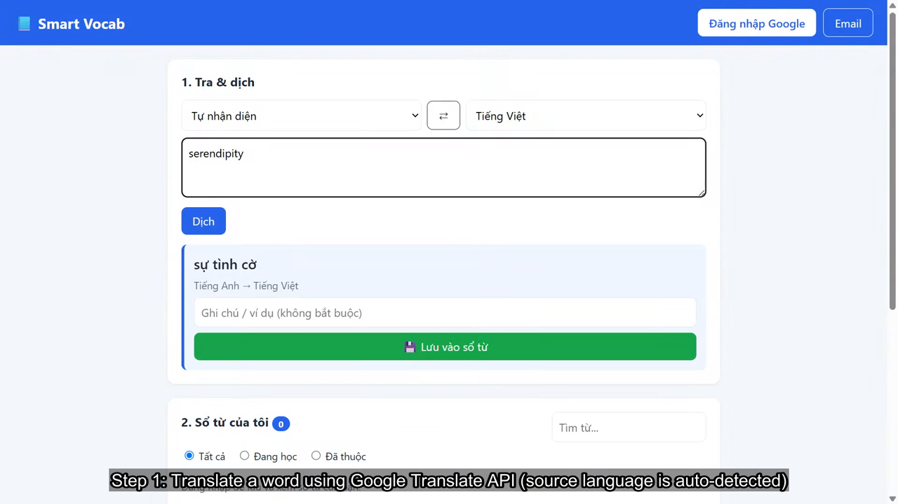
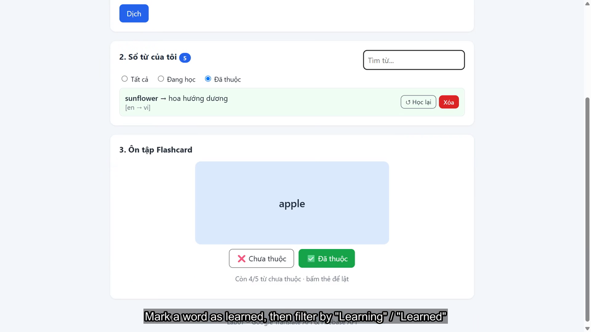

# Lab07 – Google Translate API & Firebase API

**Full name:** Nguyễn Đăng Khoa · **Student ID:** 23125084

**Product:** Smart Vocab – Smart Vocabulary Notebook

| Item | Link |
|---|---|
| 🌐 Website (live) | https://smart-vocab-d4665.web.app |
| 💻 Source code | https://github.com/KBFrom0/Private_ComputationalThinking |
| 🎬 Demo video | https://github.com/KBFrom0/Private_ComputationalThinking/blob/main/docs/demo.mp4 |

---

## 1. Explanation – Website overview

### 1.1 Idea
When learning a foreign language, learners often look words up in Google Translate and forget them right away, because there is nowhere to save them for review. **Smart Vocab** combines three steps, *look up → save → review*, in a single website:

- Look up meanings with the **Google Translate API**.
- Save words to a personal cloud notebook with **Firebase (Authentication + Cloud Firestore)**, available on any device.
- Review them with **flashcards** until they are learned.

The website is deployed on **Firebase Hosting** at https://smart-vocab-d4665.web.app.

### 1.2 Features

| # | Feature | Description | API used |
|---|---------|-------------|----------|
| 1 | Translate | Translate words/sentences between 8 languages, auto-detect the source language, swap direction | Google Translate |
| 2 | Sign in | Sign in with a Google account or Email/Password (with registration) | Firebase Authentication |
| 3 | Save words | Save a word with its meaning and an optional note; duplicates are blocked | Cloud Firestore |
| 4 | Manage notebook | View, search, filter (learning / learned), mark, delete. Realtime sync | Cloud Firestore |
| 5 | Flashcards | Flip a card to see the meaning, mark "learned" / "not yet", count reviews | Cloud Firestore |
| 6 | Data security | Each user can only read/write their own notebook | Firestore Security Rules |

### 1.3 Screenshots

**Translating a word with the Google Translate API (auto-detected English → Vietnamese):**



**Saving words to the notebook on Cloud Firestore:**


**Searching, filtering, and marking words as learned:**



**Reviewing with flashcards:**


### 1.4 Architecture

```
Browser (plain HTML/CSS/JavaScript, ES Modules)
 ├── js/translate.js ──HTTP──► Google Translate API
 └── js/firebase.js  ──SDK───► Firebase Authentication (Google, Email/Password)
                              └► Cloud Firestore: users/{uid}/words/{wordId}
Deployment: Firebase Hosting
```

| File | Role |
|------|------|
| `index.html`, `css/style.css` | User interface |
| `js/app.js` | Event handling, notebook rendering, flashcards |
| `js/translate.js` | Google Translate API calls |
| `js/firebase.js` | Firebase initialization, Auth, and Firestore operations |
| `js/config.js` | Firebase config and API key (not committed, listed in `.gitignore`) |
| `firestore.rules` | Firestore security rules |
| `firebase.json`, `.firebaserc` | Firebase deployment config |

The website is a **static app with no custom backend**: all logic runs in the browser, and data is stored in Firestore and protected by Security Rules.

### 1.5 Google Translate API integration (`js/translate.js`)

The function `translate(text, target, source)` supports two ways of calling the API:

**a) Google Cloud Translation API v2 (official, uses an API key):**
```js
const res = await fetch(
  `https://translation.googleapis.com/language/translate/v2?key=${TRANSLATE_API_KEY}`,
  {
    method: "POST",
    headers: { "Content-Type": "application/json" },
    body: JSON.stringify({ q: text, target, source, format: "text" }),
  }
);
const t = (await res.json()).data.translations[0];
// t.translatedText, t.detectedSourceLanguage
```

**b) Public Google Translate endpoint (used when no API key is set):**
```js
const params = new URLSearchParams({ client: "gtx", sl: source, tl: target, dt: "t", q: text });
const data = await (await fetch(`https://translate.googleapis.com/translate_a/single?${params}`)).json();
// data[0] = translated segments, data[2] = detected source language
```

- When "Auto-detect" is selected, the API returns the source language. It is displayed to the user (e.g. *English → Vietnamese*) and saved with the word.
- The demo uses option (b). Switching to the Cloud Translation API only requires filling in `TRANSLATE_API_KEY` in `js/config.js`; no code changes are needed.

### 1.6 Firebase integration (`js/firebase.js`)

**Authentication:** two sign-in methods are supported, and the sign-in state is tracked with `onAuthStateChanged`.
```js
export const login = () => signInWithPopup(auth, new GoogleAuthProvider());
export const loginWithEmail = (email, password) =>
  signInWithEmailAndPassword(auth, email, password);
export const onUserChanged = (cb) => onAuthStateChanged(auth, cb);
```

**Cloud Firestore:** each user has their own sub-collection `users/{uid}/words`.
```js
addDoc(collection(db, "users", uid, "words"), {
  text, translated, source, target, note,
  learned: false, reviewCount: 0, createdAt: serverTimestamp(),
});
```
- **Realtime reads** with `onSnapshot` (ordered by `createdAt`). When a word is added, deleted, or marked, the UI updates automatically on every tab and device.
- **Updates** with `updateDoc` (the `learned` status, and `reviewCount` during flashcard review); **deletes** with `deleteDoc`.

**Security Rules** (`firestore.rules`): users must be signed in and can only access data whose `userId` matches their own `uid`.
```
match /users/{userId}/words/{wordId} {
  allow read, write: if request.auth != null && request.auth.uid == userId;
}
```

**Firebase Hosting:** deployed with `firebase deploy --only hosting`.

### 1.7 How to run
See `README.md` for details. In short:
1. `cp js/config.example.js js/config.js`, then fill in `firebaseConfig` (and `TRANSLATE_API_KEY` if available).
2. In the Firebase Console: enable Authentication (Google, Email/Password), create Firestore, and apply `firestore.rules`.
3. Run locally with `npx serve .`, or deploy with `firebase deploy`.

---

## 2. Source Code
- Repository: https://github.com/KBFrom0/Private_ComputationalThinking
- Main files: `index.html`, `css/style.css`, `js/app.js`, `js/translate.js`, `js/firebase.js`, `firestore.rules`, `firebase.json`.

## 3. Video Demonstration
- Video (about 2 minutes, English subtitles): https://github.com/KBFrom0/Private_ComputationalThinking/blob/main/docs/demo.mp4
- Separate subtitle file: `docs/demo-subtitles-en.srt`
- Video content:
  1. Translate the word *serendipity* (auto-detected English → Vietnamese), then a Vietnamese sentence → Japanese.
  2. Sign in with Firebase Authentication (Email/Password).
  3. Translate and save 5 words to Cloud Firestore, with notes.
  4. Search, mark a word as learned, and filter by status.
  5. Review with flashcards.
  6. Reload the page to show the data is still in the cloud, then sign out.

## 4. AI Usage Declaration
During this lab, I used the AI tool **Claude Code (Anthropic's Claude Opus 5.5 model)** as a programming assistant:

| Area | AI assistance | My work |
|------|---------------|---------|
| Idea | Suggested 5 project ideas | Chose the *Smart Vocabulary Notebook* project |
| Source code | Generated the HTML/CSS/JS, the Translate module, Firebase Auth/Firestore, flashcards, and email sign-in | Read and understood the code, ran it, and tested the features |
| Firebase setup | Created the web app and Firestore, deployed rules and hosting via the Firebase CLI | Created the Firebase project, signed in to the CLI, enabled Google and Email/Password in the Console |
| Testing | Tested in the browser, found and fixed UI bugs | Re-tested in my own browser |
| Demo video | Drove an automated browser to record the video and created the English subtitles | Reviewed the video |
| Documentation | Wrote the README and this report, exported the PDF | Provided my personal details and reviewed the content |

Every AI-assisted commit includes a `Co-Authored-By: Claude` line in the Git history. I understand the full source code and take responsibility for everything submitted.

## 5. Git Commit History
Command: `git log --pretty=format:"%h | %ad | %s" --date=format:"%Y-%m-%d %H:%M"`

```
fd89703 | 2026-11-25 02:03 | Rewrite README in English
3318993 | 2026-11-25 01:58 | Hoàn thiện báo cáo (MD + PDF) kèm ảnh chụp màn hình
68c54cb | 2026-11-25 01:57 | Thêm video demo (phụ đề tiếng Anh) và cập nhật README
47f79eb | 2026-11-25 01:44 | Thêm đăng nhập/đăng ký bằng Email & mật khẩu (Firebase Auth)
5fd9c93 | 2026-11-25 01:36 | Liên kết project Firebase smart-vocab-d4665
8f9fd84 | 2026-11-25 01:06 | Thêm báo cáo nộp bài docs/REPORT.md
6d9b23a | 2026-11-25 01:06 | Sửa lỗi khung kết quả không ẩn, thêm favicon và chỉnh màu nút đăng nhập
3e04ad9 | 2026-11-25 01:05 | Thêm Firestore security rules, cấu hình Hosting và README hướng dẫn
7bc04b6 | 2026-11-25 01:05 | Thêm chế độ ôn tập Flashcard: lật thẻ, đánh dấu đã thuộc/chưa thuộc
ca1da3e | 2026-11-25 01:04 | Tích hợp Firebase: đăng nhập Google, lưu/xóa/đánh dấu từ trên Firestore (realtime)
f2a4d9a | 2026-11-25 01:04 | Tích hợp Google Translate API: dịch văn bản, chọn/đổi ngôn ngữ
16ead81 | 2026-11-25 01:03 | Tạo khung giao diện: layout HTML và CSS
```

Earlier commit messages are in Vietnamese. English translations:

| Commit | Meaning |
|--------|---------|
| `3318993` | Finalize the report (MD + PDF) with screenshots |
| `68c54cb` | Add demo video (English subtitles) and update README |
| `47f79eb` | Add Email & password sign-in/registration (Firebase Auth) |
| `5fd9c93` | Link the Firebase project smart-vocab-d4665 |
| `8f9fd84` | Add the submission report docs/REPORT.md |
| `6d9b23a` | Fix the result box not hiding, add favicon, adjust sign-in button color |
| `3e04ad9` | Add Firestore security rules, Hosting config, and setup README |
| `7bc04b6` | Add flashcard review mode: flip cards, mark learned / not yet |
| `ca1da3e` | Integrate Firebase: Google sign-in, save/delete/mark words in Firestore (realtime) |
| `f2a4d9a` | Integrate Google Translate API: translate text, select/swap languages |
| `16ead81` | Create the UI skeleton: HTML layout and CSS |

Full history (including commits made after this report): https://github.com/KBFrom0/Private_ComputationalThinking/commits/main
